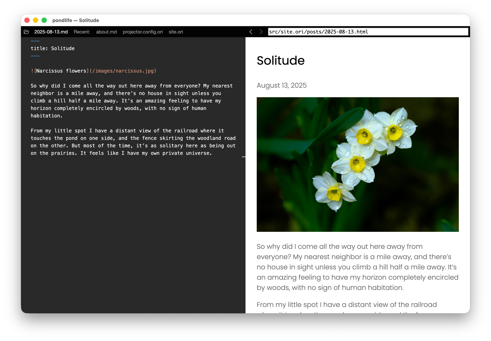

At the start of this year I began developing an application called [Origami Projector](https://github.com/WebOrigami/projector) for editing sites. The app is inspired by [Glitch](https://glitch.com), an absolutely wonderful browser-hosted site editor and community that, sadly, shut down in 2025. I've come to think that much of its value can be reembodied — and perhaps improved — as an app.

Given the zeitgeist, I'll clarify that I'm writing this app by hand; it's not vibecoded.

## An ode to Glitch

You could think of Glitch as "My First IDE" — an approachable entry point for someone looking to get started with making a site, with a great combination of features:

* A friendly tone that welcomed people who didn't think of themselves as programmers
* Sandboxed web server for previewing
* A basic code editor sitting directly next to a live preview of your site that updates as you type
* Auto-save
* Automatic installation of Node.js modules
* Automatic publishing of your site to the public web
* A built-in `.env` editor for saving secrets like credentials
* Free hosting for static sites, with reasonable pricing for dynamic sites and custom domains
* Integration with GitHub or other git hosts
* An easy, one-click operation to clone ("remix") any public Glitch project
* Dedicated user outreach that produced a vibrant user community
* The ability to do everything **without having to ever use a command line**

This was a wonderful thing. Unfortunately, Glitch was also unique, and its disappearance left behind nothing remotely as full-featured.

## Like Glitch, but an app?

Glitch came to an end for a variety of technical and economic reasons, but I'm intrigued by the possibility that at least some of its problems stemmed from its fundamental nature as a browser-hosted service. A _native_ application might avoid some of those problems.

Compared to a site, an application does have many disadvantages. The app needs to be distributed somehow. Users need some way to find it, download it, install it, and later update it. The app might have bugs that only manifest themselves on certain OSes/machines/configurations, etc. These are all the reasons we convinced ourselves that sites were better than apps in the 2000s.

But apps also enjoy some real advantages:

* Once a user has the app, _they have the app_. Assuming the app is written well and with good intentions, it should run indefinitely.
* Files are freedom. If your project is local files, you create and edit them with any tool you want. You can move them wherever you want. You can switch to another application if you want.
* Inherent privacy. This works in both directions: the user doesn't have to share their files with the app creators, and the app creators are freed from the burden of having to store potentially sensitive data.
* The marginal cost of a new user adopting the app can be very low. A user might hit problems and so add to a support burden, but the act of running the app itself happens on the user's own machine and so avoids expensive server infrastructure.
* The user's own activity in the app incurs CPU and storage costs on their own machine, not on servers run by the app creators.
* These economics might permit an open-source app to succeed where a hosted service could not.

It should be possible to reproduce most of the core Glitch features in a native app. We can use Electron to turn what's largely a platform-agnostic web app into a native app that runs on macOS, Linux, and Windows.

## Origami Projector

Projector is current intended for hand-authored HTML/CSS projects and [Web Origami](https://weborigami.org) projects. It's still at an early phase in its development, and already includes:

* An instance of the [Monaco](https://microsoft.github.io/monaco-editor/) code editor (the core of the editor in VS Code)
* A local web server with debugging features
* A side-by-side view showing the editor alongside a live view of the local server that updates as you type
* Auto-save

<iframe class="video16x9" src="https://www.youtube.com/embed/KJcAQMZNrDM" title="YouTube video player" frameborder="0" allow="accelerometer; autoplay; clipboard-write; encrypted-media; gyroscope; picture-in-picture; web-share" allowfullscreen></iframe>

_[At the time the above video was recorded, the Monaco editor hadn't been added yet.]_

Projector is currently built for macOS; Linux and Windows versions will come if there's interest.

## Publishing to web hosts

One advantage of Projector being an app instead of a service is that it can be agnostic with respect to web hosting services. The goal is that it should eventually be straightforward for the user to indicate what host they want to use and have the rest taken care of.

For now it's possible to manually configure publishing from within Projector directly to [Neocities](https://neocities.org) and [Netlify](https://netlify.com).

<iframe class="video16x9" src="https://www.youtube.com/embed/t9JivXTDzuU" title="YouTube video player" frameborder="0" allow="accelerometer; autoplay; clipboard-write; encrypted-media; gyroscope; picture-in-picture; web-share" allowfullscreen></iframe>

Although it's still early, I've been publishing to some of my sites from within Projector. It's nearly instantaneous and feels good. Until now I've published most of my sites to Netlify via continuous integration with GitHub, which is elegant for mulit-user projects but complete overkill and a major headache for individual projects.

## Let's Publish

Publishing is currently ridiculously hard:

* Many hosts only offer programmatic publishing via a proprietary API.
* Even hosts that support standard protocols like [SFTP](https://en.wikipedia.org/wiki/SSH_File_Transfer_Protocol) vary in which protocols they support, so users are forced to learn about those things.
* Setting up a connection to a host often entails ridiculously complex concepts like API tokens or public/private encryption keys. Even if you understand those things, the means to obtain a token or upload a public key is always (?) proprietary and often only possible through UI buried deep in the host's account control panel.

This is all painful. We really need a standard, easy way for a user to identify their host and have the app and host negotiate the rest — something like Let's Encrypt, but for web publishing.

Call it Let's Publish:

* The host indicates what publishing APIs it supports and indicate a preferred method
* The user selects which of those it wants to use, perhaps accepting the suggested default
* The app and host authenticate the user
* The host gives the app whatever credentials are necessary
* The app securely stores the credentials

## A tool you can set up for other people

Projector could evolve into a solid answer to an important question: if you're setting up a site for someone else — how do you let them edit their own site?

Devs routinely create sites for a client, friend, relative, or organization. The dev can make the initial site deployment, but after that point the site owner needs some way of updating site content themselves. A CMS can provide a partial but expensive answer. What if you want to give the site owner real files? How do you let them manage, edit, and publish those?

I'd like such devs to be able to tell the site's owner to install the Projector app and open something (a ZIP file with the initial project files, maybe?). Everything else — installing Node modules, setting up publishing, backing up content — should happen automatically. The owner should be able to edit and publish the site on their own without ever having to use a command line.
